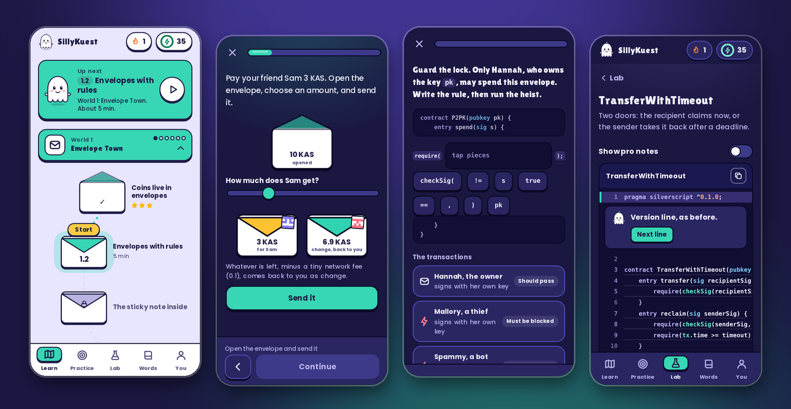
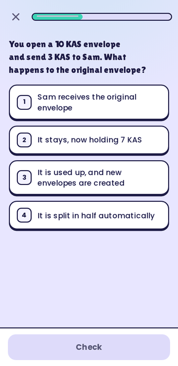
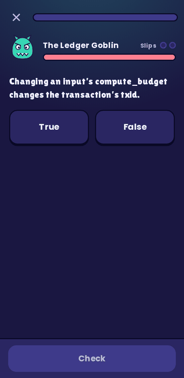
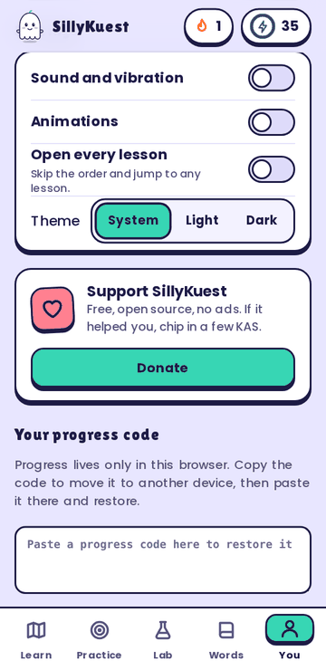
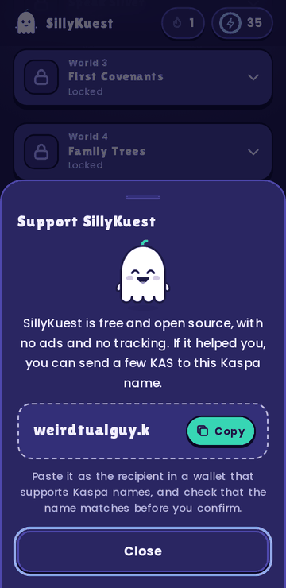

<p align="center">
  
</p>

<h1 align="center">SillyKuest</h1>

<p align="center">
  <b>Learn Kaspa, Silverscript and covenants the friendly way.</b><br>
  A game-like course for complete beginners, and for vibe coders who want to read the code their AI writes.
</p>

<p align="center">
  
  
  
  
</p>

<p align="center">
  
</p>

## What you get

- **A quest of 6 worlds**: 33 short lessons, 161 questions in 9 types, and a boss fight per world.
- **Play before you read**: 12 interactive toys and 9 annotated contracts you read one line at a time. Tap a line and Sil explains it.
- **Practice that sticks**: a Review bank for your slips, Daily five, a Code workout, **Vibe Check** (find the line an AI got wrong) and **Vault Heist** (write the rule, then watch it run against thieves).
- **A pocket reference**: 61 dictionary terms, 51 opcodes and a cheat sheet. Any term in a lesson is tappable.
- **Kind by design**: no hearts, no punishment, a daily goal you cannot lose. Light and dark themes, reduced motion, keyboard and screen reader support.
- **Yours alone**: installable, works offline, no account, no tracking. Progress stays in your browser, with a portable progress code.

## Run it

Open `index.html`. That is all, there is no build step and no dependency.

For the offline and install features, serve it over `http://localhost`:

```sh
python3 -m http.server 8080    # then visit http://localhost:8080
```

On Android with Termux: `pkg install python`, then the same command.

**Publish it on GitHub Pages**: push to `main`, then in the repository go to *Settings, Pages, Source: GitHub Actions*. The included workflow publishes only the app files.

## The teaching idea

1. **Concrete before abstract.** Everything starts as a sealed envelope with a sticky note inside. Lesson nodes, the quest map and the toys all use that picture.
2. **Jargon is earned.** Play with a toy, read the plain-words version, then a stamp reveals the real term (UTXO, covenant, P2SH). Terms in text are tappable and open the dictionary.
3. **Real code comes last, and is read line by line.** Optional **Pro corners** hold the precise detail for people who want it.
4. **No punishment.** A wrong answer shows the right one and why, then returns once later in the lesson. Misses go to the Review bank.
5. **Honest labelling.** Code written for teaching that has not been through the compiler carries a **Teaching sketch** tag.

## Screens

<table>
  <tr>
    <td align="center"><br><sub>Questions, no punishment</sub></td>
    <td align="center"><br><sub>Boss fights</sub></td>
    <td align="center"><br><sub>You: settings and support</sub></td>
    <td align="center"><br><sub>Support sheet</sub></td>
  </tr>
</table>

## Tests

```sh
npm test                 # content, Vibe Check and repo checks, Node only
npm install && npx playwright install chromium
npm run test:browser     # plays every lesson and boss, checks resume, offline and the 3.0 features
```

CI runs both on every push. Details are in [docs/AUTHORING.md](docs/AUTHORING.md).

## Contributing

New lessons, fixes and corrections are welcome. Read [CONTRIBUTING.md](CONTRIBUTING.md) and [docs/AUTHORING.md](docs/AUTHORING.md) first: they cover the lesson format, the checks, and how accuracy is kept honest.

## Support

SillyKuest is free and has no ads. If it helped you, you can send some KAS to the Kaspa name:

```
weirdtualguy.k
```

The same name is behind the **Donate** button in the app (You tab). Check that the name matches in your wallet before you confirm.

## Accuracy

Silverscript, Argent and vprogs APIs move fast. None of the Silverscript on screen has been run through the compiler here. SillyKuest is a learning tool, not audited guidance: check the official repositories before writing production code.

## License

MIT, see [LICENSE](LICENSE). The embedded fonts (Poppins, Lilita One) are under the SIL Open Font License 1.1, see [THIRD_PARTY.md](THIRD_PARTY.md).
